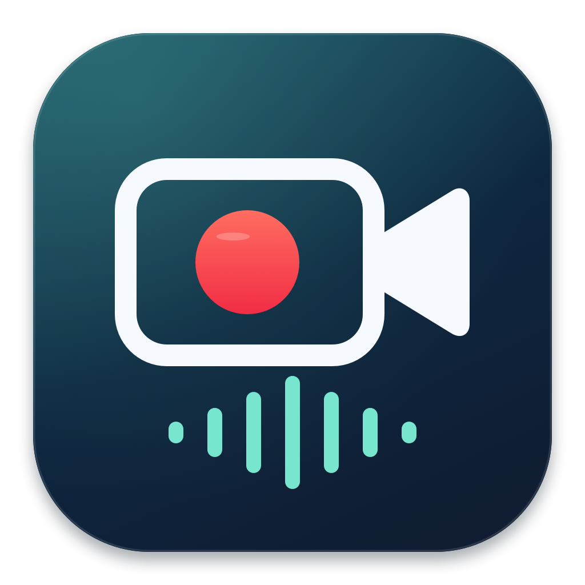
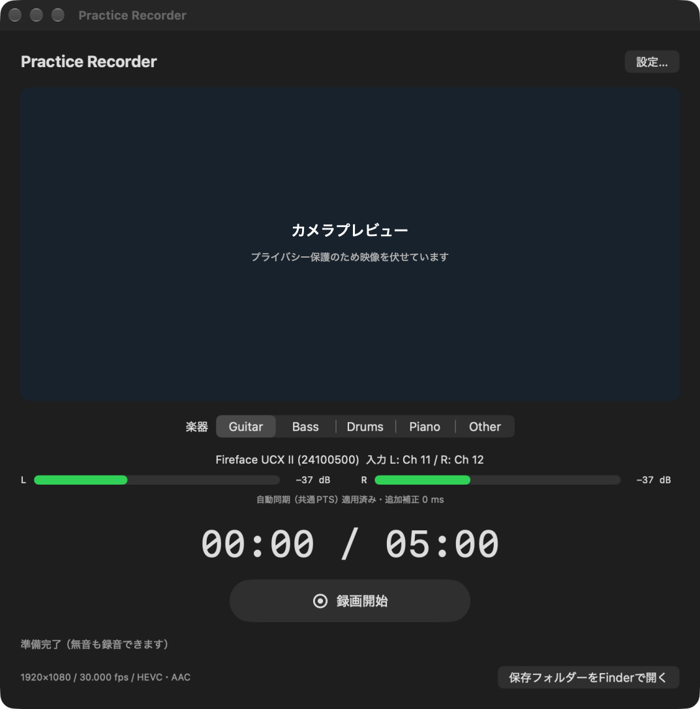
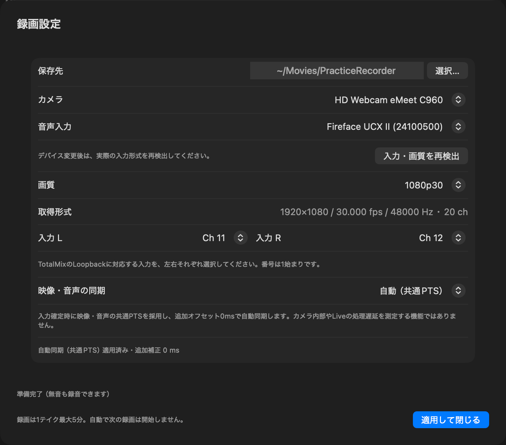

# Practice Recorder



**楽器を選んで、録画開始。WebカメラとRME Loopbackの音を、最大5分のMP4へ保存するmacOSアプリです。**

SwiftUI / AVFoundation / VideoToolboxで動作します。OBSや録画用の外部プロセスは不要です。Live・TotalMixのルーティングはそのまま使い、アプリ自身は音声を出力しません。



*実機のメイン画面。プライバシー保護のため、カメラ映像の部分だけを伏せています。*

| 項目 | 内容 |
|---|---|
| バージョン | 1.1.1 |
| 対象 | Apple Silicon、macOS 15以降 |
| 入力 | Webカメラ1台 + 選択した音声デバイスの任意L/R |
| 保存形式 | HEVC映像 + AACステレオ音声 / MP4 |
| 録画上限 | 300秒で自動停止・保存。次の録画は始めません |
| 分類 | Guitar / Bass / Drums / Piano / Other |
| 初期保存先 | `~/Movies/PracticeRecorder/` |
| 同期 | 入力確定時に共通PTSによる自動同期を適用。手動補正も選択可 |

## ビルドして起動する

XcodeのSwift toolchainが必要です。外部パッケージのインストールは不要です。

```sh
./scripts/build-app.sh
open 'build/Practice Recorder.app'
```

アプリは**この作業ディレクトリの `build/Practice Recorder.app`** に生成されます。ソースから同じパスへ再生成できます。`.app`やSwiftPMのビルド生成物はGitに含めていません。

bundle IDは `jp.local.PracticeRecorder`。ローカルad-hoc署名・hardened runtimeを使用し、App Sandboxは無効です。開発者証明書・notarizationは前提にしていません。最低OSはmacOS 15、Swift tools 6.0 / 言語モードSwift 5を指定しています。

### 初回の権限

カメラとマイクへのアクセスを許可してください。マイク権限は、RMEの音声入力を取得するためにも必要です。

拒否した場合は「システム設定 → プライバシーとセキュリティ → カメラ／マイク」でPractice Recorderを許可し、アプリを再起動します。画面収録・アクセシビリティ・Input Monitoring・フルディスクアクセスは、アプリの利用には不要です。

## 最初の設定

1. 「設定…」を開き、カメラとRME音声入力デバイスを選びます。
2. カメラが対応する画質を選び、「入力・画質を再検出」を押します。
3. 実際の音声形式とチャンネル数が表示されたら、Loopbackに対応する**入力Lと入力Rを個別に選択**します。
4. 必要なら保存先を変更し、「適用して閉じる」を押します。
5. プレビュー、選択したL/Rのメーター、「準備完了」「自動同期（共通PTS）適用済み」を確認します。



*実機の設定画面。保存先のユーザー固有部分は `~` 表記に置き換えています。機器名・チャンネルは設定例です。*

UIのチャンネル番号は**1始まり**です。この環境では、ユーザー設定済みのLoopbackが **Ch11/12** なので、L=Ch11、R=Ch12を使用しています。内部indexは10/11です。初期状態ではL/Rを未選択とし、1/2や内蔵マイクへ自動切替はしません。

デバイス・L/R・保存先・画質・同期モード・楽器を記憶します。楽器の選択は分類用で、LiveやRMEのルーティングは変えません。

## 日常の録画

1. Guitar / Bass / Drums / Piano / Otherから楽器を選びます。
2. 「録画開始」または **⌘R** を押します。
3. 終えるときは「停止して保存」または **⌘R**。停止しなくても300秒で保存します。
4. 「保存しました」の表示後、「保存フォルダーをFinderで開く」からファイルを確認できます。

直前の楽器を記憶するため、通常は録画ボタン1回で開始できます。⌘Rはアプリにフォーカスがある時だけ有効です。録画中・保存中は楽器や入力設定を変更できません。経過時間は最大 `REC 05:00 / 05:00` で止まり、保存にかかった時間を録画時間へ加算しません。

無音でも有効な音声バッファが届いていれば録画できます。入力断は無音と区別し、停止・可能なら中断保存します。録画中にウィンドウを閉じる／アプリを終了する場合も、停止して保存を試みてから終了します。

## RME / TotalMix FXの設定

音声経路は次のとおりです。

```text
楽器 → RME → Ableton Live → RME Software Playback
                                  ↓
                  TotalMixの録画用サブミックス / Loopback
                                  ↓
                 Practice Recorderで選択した入力L/R
```

1. 既存の楽器入力やモニターを邪魔しないHardware Outputと、その対応入力ペアを選びます。特定のペアが空いているとは仮定しません。
2. その出力サブミックスへ、Liveが出しているSoftware Playbackを送ります。
3. Liveの音だけを録るなら、同じ演奏の生入力を二重に混ぜないようにします。
4. その出力のLoopbackをONにし、本アプリで対応する入力L/Rを選びます。
5. 本アプリのL/Rメーターと短いテスト録画で確認します。TotalMixの物理入力メーターだけでは、Loopbackの収録状態を判定できません。
6. LiveでLoopback入力を同じ出力へ再モニターしないでください。

アプリはRMEのサンプルレート・クロック・バッファ、macOSのデフォルト入出力、TotalMixの設定を変更しません。音声モニター出力、AGC、ノイズ抑制も追加しません。

Loopbackは、出力サブミックスを対応する録音入力へ戻す機能です。高サンプルレートではADAT等の有効チャンネルが減るため、列挙数だけで信号が有効とは断定しないでください。[UCX II公式マニュアル §27.6 / §15.4](https://rme-audio.de/downloads/fface_ucx2_e.pdf)も参照してください。

## 自動同期と手動補正

初期設定は**「自動（共通PTS）」**です。カメラと選択したRME入力の実サンプルがそろうと、自動で適用します。同じAVCaptureSessionの音声・映像PTSを共通の開始時刻で扱い、ストリームごとに別々のゼロ起点へ直しません。自動モードの追加補正は0msです。

入力変更・入力断では適用状態を無効にし、次の入力準備完了時に再適用します。録画開始時に同期設定を固定し、そのテイク中は変更しません。

これは**共通PTSによる同期**であり、カメラ内部やLiveプラグイン等を含む物理的な遅延を自動測定するものではありません。最初のPTSの差やコールバック到着差を、遅延の補正値に流用しません。[Appleのcapture session clock説明](https://developer.apple.com/documentation/avfoundation/avcapturesession/synchronizationclock)も参照してください。

固定的なズレを調整する場合は、設定で「手動補正」へ切り替えます。

| 補正値 | 意味 |
|---|---|
| `+100ms` | 映像に対して音声を100ms遅らせる |
| `−100ms` | 映像に対して音声を100ms早める |
| 範囲 | −500〜+500ms、10ms刻み |

音声PTSへ一度だけ適用し、開始前／300秒後のPCMを切り詰めます。自動モードでは保存済みの手動値を適用しません。手動値そのものは残るため、モードを戻すと再利用できます。固定補正はクロックのドリフト補正ではありません。

## 画質と音声形式

| 画質 | 映像目標ビットレート |
|---|---|
| 1920×1080 / 30fps | 3Mbps |
| 1920×1080 / 60fps | 5Mbps |
| 1280×720 / 30fps | 1.5Mbps |

カメラの実対応候補だけを表示します。29.97/59.94fps等は実際の分数レートを保持し、フレーム複製やアップスケールで見せかけません。設定レートと実際に届くフレーム数は異なる場合があります。

SDR / 8bit、HEVCハードウェアエンコードを使用します。設定やエンコーダー開始に失敗した場合、H.264やソフトウェアへ黙って切り替えません。AACは192kbpsステレオで、入力と同じ44.1/48kHzを使用します。高レート入力はデバイス設定を変更せず、説明付きで拒否します。ビットレートは目標値で、厳密なファイルサイズの保証値ではありません。

## 保存先とファイル名

デフォルトは `~/Movies/PracticeRecorder/`。楽器／開始時の年／月に分類します。

```text
PracticeRecorder/
  guitar/2026/10/
    guitar-2026-10-29-141530-05m00s-7f3a9c2d.mp4
  bass/2026/10/
  drums/2026/10/
  piano/2026/10/
  other/2026/10/
```

名前には開始時のローカル日時、完成ファイルの実測尺、衝突防止IDを含めます。尺は最近秒へ四捨五入し、最大表記は05m00s。開始時のタイムゾーンも固定します。既存ファイルは上書きしません。

録画中は同じディレクトリ内の `.recording-UUID.partial.mp4` に書きます。writer完了・HEVC/AACトラック・正の有限尺を検証後、排他的renameで最終名にし、その後に保存完了を表示します。

中断した録画が保存・検証できた場合は `-interrupted.mp4` として通知します。失敗時はpartialを残し、場所と理由を表示します。partialは自動削除しません。強制終了／電源断した通常MP4の復旧は保証できません。

開始前に書込み可否と空き容量を確認します。保存処理にはtimeoutがありますが、OS内で既に開始したファイルI/Oは取り消せません。timeout時はpartialまたは保存先を確認してください。ネットワーク先への直接録画は保証対象外です。履歴DBや録画ごとのJSONは生成しません。

## 困ったとき

| 症状 | 確認すること |
|---|---|
| カメラ／音声の許可エラー | システム設定のカメラ・マイクでPractice Recorderを許可し、再起動する |
| 再ビルド後、カメラ許可ONでも準備が進まない | Practice Recorder自身のカメラ許可だけを一度OFF→ONにし、OSの「終了して再度開く」で反映する。この環境で実際に必要だった手順 |
| メーターが動かない | 選択L/RとTotalMixのLoopback対応入力、LiveのSoftware Playbackを確認する |
| 「入力が途絶えた」「形式が変わった」 | 接続・既存の音声環境を確認後、設定から再検出・適用する。別の入力へ自動切替はしない |
| 対応画質を選べない | カメラ選択を確認し、実対応する画質を選ぶ |
| 保存エラー | 表示されたpartial／保存先、空き容量、書込み権限、外付け接続を確認する |

権限の回避策としてフルディスクアクセス等を追加したり、全アプリの権限をリセットしたりする必要はありません。アプリに新たな許可が必要になった場合は、カメラ／マイクの範囲を確認してください。

## テスト・検証記録

```sh
# 合成PCM・PTS・状態・保存と、実HW HEVC encoderの試験
./scripts/test.sh

# 明示的な実機試験（対象ハードウェアと権限が必要）
PRACTICE_RECORDER_HARDWARE_TEST=1 ./scripts/test.sh
```

実機試験は `Tests/PracticeRecorderTests/CaptureTests.swift` に記載した開発環境の機器UIDを使用します。通常実行では実機試験2件をskipします。writer試験にはハードウェアHEVC encoderが必要です。利用できない環境ではwriter試験が失敗し、ソフトウェアへ置き換えて合格にはしません。

実施済みの確認には、50件のテスト、実時間5分・最小化中の自動停止、QuickTimeでの再生、録画中の終了・保存があります。バージョンごとの実行条件と未確認事項は **[TEST_RESULTS.md](TEST_RESULTS.md)**、ログは [Validation/](Validation/) を参照してください。実A/V固定ずれ・ドリフトのクラップ測定は未実施で、「音ズレゼロ」とは判定していません。

診断用のコマンドも用意しています。

```sh
# デバイスと対応画質を列挙
swift run PracticeRecorderCheck --list

# 指定デバイスと1始まりL/Rで短時間録画
swift run PracticeRecorderCheck --camera CAMERA_UID --audio AUDIO_UID --left 11 --right 12 --seconds 6

# 出力のcodec・トラック終端・実測尺・デコード音声レベル
./scripts/inspect-output.sh /absolute/path/to/file.mp4

# CoreAudio設定の読取り専用スナップショット
swift scripts/audio-state.swift
```

診断録画・合成テストのファイルは、特に保存先を指定しなければ一時ディレクトリへ生成します。RME設定を書き換えるコマンドではありません。

## ソース構成

| パス | 役割 |
|---|---|
| `Sources/PracticeRecorderCore/` | 不変設定snapshot、同期方針、状態遷移、期限、命名、安全保存 |
| `Sources/PracticeRecorderMedia/Capture/` | 単一capture session、実形式検査、任意L/R抽出、メーター |
| `Sources/PracticeRecorderMedia/Recording/` | HEVC/AAC writer、共通PTS、補正、300秒境界、冪等finish |
| `Sources/PracticeRecorderApp/` | SwiftUI、設定、MainActor状態所有、権限、独立watchdog、終了処理 |
| `Sources/PracticeRecorderCheck/` | 明示的なデバイス診断・録画CLI |
| `Tests/` | 合成・実writer・設定移行・実機opt-in試験 |
| `AppResources/` | Info.plist、entitlements、アイコン原画とicns |
| `scripts/` | build / test / icon生成 / 診断 |
| `docs/screenshots/` | README掲載用の実画面（プレビューはマスク済み） |

captureの構築・開始停止、sampleのdelivery、writerはそれぞれ直列queueで管理します。sample bufferの所有権を保持し、writerの保留数を制限します。映像の破棄数を診断logへ残し、音声の不連続や持続的backpressureは異常として停止します。録画・保存中だけ通常のidle sleepを抑制します。

アイコンは `scripts/make-icon.swift` のAppKit描画から再生成できます。

```sh
./scripts/make-icon.sh
```

元の実装仕様は [PracticeRecorder-HANDOFF.md](PracticeRecorder-HANDOFF.md)。Live API、Process Tap、SMPTE、編集、履歴ライブラリ、連続自動録画は対象外です。
